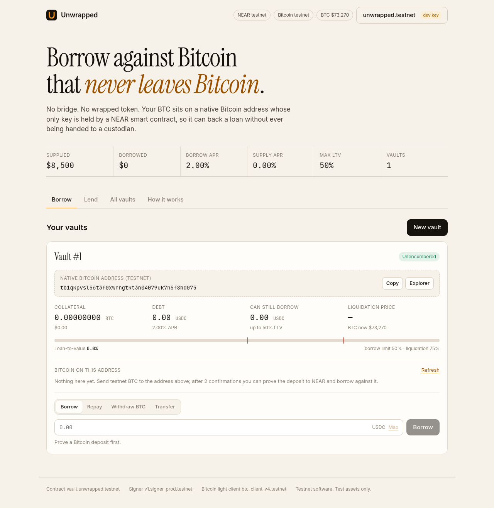
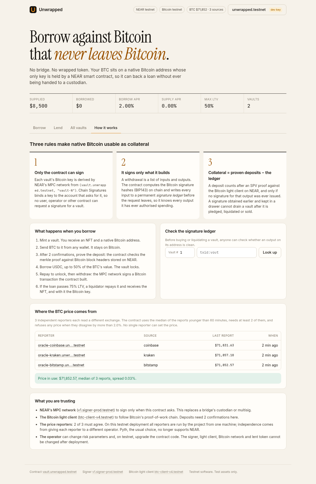

# Unwrapped

**Borrow stablecoins against Bitcoin that never leaves Bitcoin. No bridge, no wrapped token.**

Built at NEAR HACKATHON (November 2026). Tracks: Unstoppable DeFi, NFTs That Do Something, Open Innovation.



## The problem

To borrow against BTC in DeFi today you first hand it to a bridge or a custodian and receive a wrapped token (wBTC, cbBTC, tBTC). The loan is then only as safe as that bridge, and bridges are where most of the money stolen in crypto has been stolen from.

## What Unwrapped is

A lending protocol on NEAR where the collateral is **native BTC sitting on a normal Bitcoin address**.

- A **vault** is an NFT (NEP-171). Each vault controls its own Bitcoin address through [NEAR Chain Signatures](https://docs.near.org/chain-abstraction/chain-signatures): the key lives in NEAR's MPC network and only the Unwrapped contract can ask it to sign.
- You send BTC to the vault address from any wallet and prove the deposit to the contract with an SPV proof, checked against the Bitcoin light client that runs on NEAR.
- You borrow USDC from a lending pool against that BTC. To get the BTC out, the contract builds the Bitcoin transaction, the MPC network signs it, and you broadcast it.
- If the loan becomes unsafe, a liquidator repays it and receives the NFT, and with it the Bitcoin key.

Nothing is bridged and nothing is wrapped. The only thing that moves on NEAR is the right to make the contract sign.

## Why this is not trivial: the signature in the drawer

Giving a contract a Bitcoin key is the easy part. The hard part is that a Bitcoin signature, once issued, is valid forever. An owner could ask for a signature that sweeps the vault, keep it off-chain, then pledge the same BTC, borrow, and broadcast the old signature. The same trick would rob a liquidator or anyone who buys a vault.

Unwrapped closes this with three rules, all enforced on chain:

1. **Only the contract can sign.** The MPC network derives each vault key from `(contract account, "vault-<id>")`. Chain Signatures binds a key to the account that requests it, so no user, operator or other contract can obtain a signature for a vault.
2. **The contract signs only what it builds.** A withdrawal is described by its inputs and outputs. The contract computes the BIP143 signature hashes itself and writes every input to a permanent **signature ledger** before the request leaves, so the entry exists even if the request fails.
3. **Collateral = proven deposits − the signature ledger.** A deposit counts only after an SPV proof with enough confirmations, and only if no signature spending that output was ever requested.

A drawer signature therefore always spends an output that is in the ledger, and an output in the ledger can never be collateral. `presigned_spend_can_never_become_collateral` in the test suite runs exactly this attack.



## Try it

Three ways, from no setup to the live deployment.

### 1. Run the tests (no accounts, no network keys)

Requires Rust with the `wasm32-unknown-unknown` target.

```sh
./scripts/test.sh
```

Expected: `14 passed` (unit tests) and `16 passed` (sandbox tests). The sandbox tests run on a local NEAR node and take about five minutes.

Bitcoin is not mocked away in these tests. Deposits are real Bitcoin transactions placed in merkle trees and proven with real SPV proofs, and every withdrawal the contract returns is decoded and signature-checked with the [`bitcoin`](https://crates.io/crates/bitcoin) crate. Two things are stand-ins: the source of block headers (`contracts/mock-btc-client`, same interface and checks as the real light client) and the MPC network (`contracts/mock-signer`, which signs with real secp256k1 keys).

| Test | What it shows |
| --- | --- |
| `vault_is_an_nft_that_owns_a_native_bitcoin_address` | The address the contract reports is the P2WPKH address of the MPC-derived key; the vault is a standard NEP-171 token |
| `deposit_counts_only_with_a_valid_spv_proof` | Wrong address, too few confirmations, forged transaction, wrong block and replays are all rejected |
| `withdrawal_is_a_valid_signed_bitcoin_transaction` | The returned transaction decodes and every witness verifies under the vault key |
| `presigned_spend_can_never_become_collateral` | The drawer attack fails, also after the vault is sold |
| `a_failed_mpc_request_still_marks_the_outpoint_as_signed` | The ledger assumes the worst when a signing request fails |
| `one_vault_cannot_burn_another_vaults_deposit` | The ledger cannot be used to block someone else's deposit |
| `ledger_entries_are_paid_for_and_dust_cannot_clog_a_vault` | Storage and dust griefing are priced out |
| `borrowing_locks_the_vault_and_repaying_unlocks_it` | A pledged vault cannot be transferred or emptied; repayment by anyone unlocks it |
| `partial_withdrawal_is_allowed_while_the_loan_stays_safe` | BTC can leave a pledged vault only while the loan stays under the maximum LTV |
| `liquidation_hands_the_bitcoin_key_to_the_liquidator` | Liquidator pays, receives the NFT and can sign; lenders are repaid; the borrower gets the surplus |
| `an_underwater_vault_is_liquidated_and_the_loss_is_shared_by_lenders` | Bad debt is written off through the share price |
| `lenders_earn_the_interest_borrowers_pay` | Interest accrues and reaches lenders |
| `a_stale_price_blocks_borrowing_and_liquidation` | Oracle freshness, oracle and operator permissions, immutable configuration |
| `no_single_reporter_controls_the_price` | A lying reporter is outvoted by the median or, past the spread limit, switches the price off; a lone reporter has no quorum |
| `migration_from_the_single_oracle_version_keeps_all_state` | The exact code that was live on testnet is upgraded in place; vaults, loans, ledger entries and lender shares survive |
| `payouts_to_unregistered_accounts_are_held_not_lost` | Undeliverable payouts stay claimable; other tokens are refused |

On hosts with glibc older than 2.39 (for example Ubuntu 22.04) the sandbox binary that `near-workspaces` downloads does not start. Set `NEAR_SANDBOX_BIN_PATH` to a working `near-sandbox` binary and rerun.

JavaScript tests for the client library (merkle proofs against Bitcoin block 100000, address decoding against BIP173/BIP350 vectors, withdrawal planning):

```sh
npm install
npm run test:js      # expected: 10 passed
```

### 2. Use the live testnet deployment from the command line

Requires Node 22 or newer.

| | |
| --- | --- |
| Contract | [`vault.unwrapped.testnet`](https://testnet.nearblocks.io/address/vault.unwrapped.testnet) |
| Test stablecoin | [`usdc.unwrapped.testnet`](https://testnet.nearblocks.io/address/usdc.unwrapped.testnet) |
| Chain Signatures contract | `v1.signer-prod.testnet` |
| Bitcoin light client | `btc-client-v4.testnet` (Bitcoin testnet3) |

```sh
npm install
npm run cli -- status
```

Expected: the pool size, BTC price, risk parameters and the three contract addresses above.

To act, you need a testnet account. This creates one with 10 NEAR from the public faucet and stores its key under `~/.near-credentials/testnet/`:

```sh
npm run cli -- account create <your-name>.testnet
export UNWRAPPED_ACCOUNT=<your-name>.testnet
```

**See the real MPC network sign a Bitcoin transaction (about 10 seconds, no BTC needed):**

```sh
npm run cli -- mint          # prints your vault id and its tb1q… address
npm run cli -- selftest <vault_id>
```

Expected output of `selftest`:

```
MPC network answered in 7.3s
  bitcoin txid            <64 hex characters>
  witness public key      matches the vault key
  ECDSA signature (low-S) valid for the BIP143 digest
  ledger entry            signed
```

`selftest` has the contract sign a transaction spending a made-up outpoint, then recomputes the BIP143 digest locally and verifies the signature the MPC network returned against the vault's public key. Nothing real is spent; the made-up outpoint lands in the signature ledger.

**The full loan cycle with real testnet BTC:**

```sh
# 1. Send Bitcoin testnet3 coins to the vault address from a faucet or wallet.
npm run cli -- vault <vault_id>                 # shows the address and what has arrived

# 2. After 2 confirmations, prove the deposit to NEAR.
npm run cli -- prove <vault_id>                 # "proved 0.00100000 BTC (…, block N)"

# 3. Borrow against it (at most 50% of its value).
npm run cli -- borrow <vault_id> 20             # "borrowed 20.00 USDC against vault #N"

# 4. While the loan is open, this is refused:
npm run cli -- withdraw-btc <vault_id> <tb1…address> max
#    "withdrawal would leave the loan above the maximum loan-to-value"

# 5. Repay, then withdraw: the MPC network signs, the CLI broadcasts.
npm run cli -- repay <vault_id> all
npm run cli -- withdraw-btc <vault_id> <tb1…address> max
#    "broadcast to Bitcoin: https://mempool.space/testnet/tx/…"
```

Lender and liquidator commands: `faucet` (10,000 test USDC), `supply`, `withdraw`, `liquidate`, `claim`. Run `npm run cli -- help` for the full list.

### 3. Use the web app

```sh
npm install
npm run dev -w app      # http://localhost:5173
```

Connect a NEAR testnet wallet, or choose "Use a testnet key instead" and paste the account and private key the CLI created (the key stays in the tab's session storage). The app covers the whole flow: mint a vault, watch Bitcoin arrive at its address, prove the deposit, borrow, repay, withdraw BTC (the browser re-verifies the MPC signatures before broadcasting), lend, liquidate, and look up any output in the signature ledger.

`npm run build -w app` produces a static site in `app/dist`; `.github/workflows/pages.yml` publishes it to GitHub Pages.

## What has been verified where

| Claim | Evidence |
| --- | --- |
| Contract logic, including the attacks above | 30 automated tests (`./scripts/test.sh`) |
| A vault key from the real MPC network gives a real Bitcoin address | Vault #1 minted on testnet: [transaction](https://testnet.nearblocks.io/txns/66x2Y3cXBETX2gTCciY4uGwuxT9KVitgoapwXEjf3Bc) |
| The real MPC network signs the digests the contract computes, and the signature is valid Bitcoin | `selftest` on testnet: [transaction](https://testnet.nearblocks.io/txns/948i1N8w3b9EQ2vdSBzDPpHA8DkH6XaQeVzt7vnBPLyj); eight inputs in one transaction also fit in the gas limit |
| The real light client accepts this project's proof format | `verify_transaction_inclusion_v2` on `btc-client-v4.testnet` returned `true` for proofs built from live Bitcoin testnet blocks and `false` for a wrong transaction id |
| Lending pool on testnet | Supply transactions on the deployed pool, from the CLI and from the web app |
| Full loan cycle with real Bitcoin testnet3 coins on the live deployment | See the walkthrough below |
| Upgrade of the live contract to the multi-reporter oracle, with state kept | [Upgrade transaction](https://testnet.nearblocks.io/txns/6gceEpHFFdXC1P8B5ifNNMZujAF441BRJzrhYC289912); afterwards vault #2 still held its 105,627 sats and borrowed and repaid on the new price ([borrow](https://testnet.nearblocks.io/txns/6gx18669h4gbRdqwpteKmYMK6e6tNHjXtg2p6ogNZUEi), [repay](https://testnet.nearblocks.io/txns/GpNM7oMa95DX3QQ21wEGyZLv1gkXMyrS5NKGCA2K6TEJ)) |

### The full cycle, with real BTC (12 November 2026)

Vault #1 received 105,847 sats in Bitcoin testnet3 transaction [`0b5e52ed…4c1c`](https://mempool.space/testnet/tx/0b5e52ed9d51c67848fedfbeb6fb7f75cfd0f68fa39a11d272430055b80d4c1c) (block 5,345,731).

| Step | What happened | Transaction |
| --- | --- | --- |
| 1. Prove | The deposit was proven against `btc-client-v4.testnet` and counted as 0.00105847 BTC of collateral | |
| 2. Borrow | 20 USDC borrowed at 26% LTV; the vault locked | [NEAR](https://testnet.nearblocks.io/txns/PES5p1M39FbRUHC8aN2NPgNsjPRmqEFu2nyXQ7J6GMD) |
| 3. Try to escape | Withdrawing all BTC while the loan was open was refused: `withdrawal would leave the loan above the maximum loan-to-value`. The output stayed `collateral` | [NEAR (failed, as intended)](https://testnet.nearblocks.io/txns/9hZcz4Q8y1bzH9LrMvXaPXvACMtCu3eu9FYYfq5TvsWy) |
| 4. Repay | Loan repaid in full; the vault unlocked | [NEAR](https://testnet.nearblocks.io/txns/9XtHJFpDfVTrfTGRJsT9biRogtKuVjSmpBm1WHHe7zRz) |
| 5. Withdraw | The contract built the Bitcoin transaction, NEAR's MPC network signed it, and Bitcoin accepted it: 105,627 sats to vault #2's address, 220 sats fee | [NEAR](https://testnet.nearblocks.io/txns/CjAE5ouF5isAtaDTrn4iCq2ih5aZURMabxGaeeC2C5rT) · [Bitcoin](https://mempool.space/testnet/tx/0e1ac4f44a279cc779d68830de2bbaaade69f47a1a95a28cb5cb0d884b0b3fc6) (block 5,345,746) |
| 6. Prove again | After 2 confirmations the same coins were proven as collateral of vault #2: a transaction signed by NEAR's MPC network, mined by Bitcoin, verified by the light client on NEAR | [NEAR](https://testnet.nearblocks.io/txns/7rCwGKiAk24nwXfNbCVLwfQ1yits33DTkkGSvwjhjkG) |

No bridge and no wrapped token appear anywhere in this list: the BTC went from one native Bitcoin address to another, and NEAR only decided when the key could sign.

## The BTC price

A lending protocol is only as honest as its price. Unwrapped does not trust any single account with it.

- Three reporters, `oracle-coinbase`, `oracle-kraken` and `oracle-bitstamp` (`.unwrapped.testnet`), each read a different exchange and post with their own key (`report_price`).
- The contract computes the price when it is read: the **median** of the reports younger than `max_price_age_sec` (1 hour), only if at least `min_oracle_reports` (2) exist, and only if the highest and lowest are within `max_oracle_spread_bps` (2%).
- One lying reporter is outvoted by the median. If the honest ones are missing it can move the price by at most half the spread limit; beyond that the reporters "disagree" and there is no price.
- Without a price, borrowing, collateral withdrawals and liquidations pause. Repaying never needs a price.

```sh
npm run cli -- price      # the price in use and every reporter's latest report
npm run cli -- keeper     # each reporter posts its exchange's price every 5 minutes
```

**Why not Pyth.** Pyth was the first choice. It turned out that Pyth Core dropped NEAR in its 26 August 2026 upgrade: the docs list NEAR among chains no longer supported, the last BTC/USD update on `pyth-oracle.near` is from August 2026, `pyth-oracle.testnet` has no BTC feed at all, and Hermes, the service that serves update payloads, now requires a paid API key. RHEA's multi-reporter `priceoracle.near` has not received reports since 2025. A reporter set with a quorum is the honest option available on NEAR today.

## How NEAR is used

| NEAR feature | Role here |
| --- | --- |
| Chain Signatures (MPC) | Holds every vault's Bitcoin key. The contract calls `derived_public_key` once per vault and `sign` once per withdrawal input |
| Bitcoin light client contract | Trustless deposit verification: `verify_transaction_inclusion_v2` checks a merkle proof plus a coinbase proof against stored block headers |
| NEP-171 / 177 / 178 / 181 | The vault is a standard NFT (transfer, approvals, enumeration, metadata), so wallets and marketplaces can hold it |
| NEP-141 `ft_transfer_call` | Supply, repay and liquidate are single transfers with a JSON message; unused amounts are refunded by the token |
| Promises and callbacks | Up to eight MPC signatures are requested in parallel and assembled into one raw Bitcoin transaction in the callback |

This design depends on NEAR specifically: a contract-owned MPC key and a Bitcoin light client that other contracts can call synchronously in one promise chain.

## Contract interface

`contracts/unwrapped`, about 2,300 lines of Rust including its unit tests.

| Method | Who | What |
| --- | --- | --- |
| `mint_vault()` | anyone, pays `mint_fee` | Derives a key, mints the NFT, returns the vault with its Bitcoin address |
| `prove_deposit(vault_id, tx_hex, vout, block_hash, tx_index, merkle_proof, coinbase_tx_id, coinbase_merkle_proof)` | anyone | Registers a confirmed deposit as collateral |
| `sign_withdrawal(vault_id, inputs, outputs)` | vault owner, pays `ledger_fee` per input | Returns a fully signed raw Bitcoin transaction |
| `borrow(vault_id, amount)` | vault owner | Borrows USDC; locks the vault |
| `ft_on_transfer` with `{"action":"supply"}` | anyone | Lends USDC to the pool |
| `ft_on_transfer` with `{"action":"repay","vault_id":N}` | anyone | Repays a vault's debt |
| `ft_on_transfer` with `{"action":"liquidate","vault_id":N}` | anyone but the owner | Buys an unhealthy vault |
| `withdraw(shares)`, `claim()` | lender, anyone | Takes liquidity out; collects held USDC |
| `report_price(usdc_per_btc)` | configured reporters | Posts the caller's own report, replacing its previous one |
| `update_config(config)` | operator | Changes risk and oracle parameters only |
| `migrate_to_multi_oracle(...)` | the contract itself | One-time upgrade from the single-oracle version |
| `get_vault`, `get_vaults`, `vaults_of`, `outpoint_state`, `get_pool`, `liquidation_quote`, `get_config`, `get_price`, `price_error`, `get_price_reports` | views | |

Lending parameters on the testnet deployment: maximum LTV 50%, liquidation above 75% LTV, liquidator discount 5%, borrow APR from 2% to 20% linear in utilisation. A liquidator pays 95% of the collateral's oracle value; the debt is repaid to the pool first and the remainder is credited to the borrower.

## Trust assumptions and limits

Stated plainly, because a lending protocol is only as good as its weakest assumption.

- **NEAR's MPC network** must sign only when the contract asks. This is the assumption that replaces a bridge.
- **The Bitcoin light client** must follow the real chain. The testnet deployment requires 2 confirmations and Bitcoin testnet3 allows minimum-difficulty blocks, so it is not reorg-safe; a mainnet deployment should require 6.
- **The price reporters**: 2 of 3 must agree within 2%. On the testnet deployment all three are run by the project, from one machine, so their independence is only as good as that; in production each reporter belongs to a different operator. `npm run cli -- keeper` runs them from a terminal, and `.github/workflows/keeper.yml` every 30 minutes once their keys are added as the `ORACLE_KEYS` repository secret. When nobody runs them the price expires after an hour and borrowing pauses.
- **The operator** can change risk parameters and the reporter list, and on testnet still holds a key that can upgrade the contract code (that key was used once, for the oracle migration). The signer, light client, Bitcoin network and lent token are fixed at deployment.
- **Vault addresses are P2WPKH only**, and a withdrawal has at most 8 inputs and 8 outputs.
- **Liquidation is all-or-nothing**: the liquidator buys the whole vault. There are no partial liquidations or auctions.
- **Selling a vault is not atomic with its collateral.** The ledger tells a buyer exactly which outputs are clean (`outpoint_state`), but a seller can still request a withdrawal just before a sale settles. A marketplace should check `collateral_sats` in the same transaction as the purchase. Liquidation does not have this problem because it happens inside the contract.
- The contracts have not been audited. Testnet only.

## Repository layout

```
contracts/unwrapped         the protocol: btc.rs (Bitcoin primitives), vault.rs, pool.rs, nft.rs
contracts/mock-signer       sandbox stand-in for the Chain Signatures contract
contracts/mock-btc-client   sandbox stand-in for the Bitcoin light client
contracts/mock-ft           test stablecoin with a public faucet
integration-tests           end-to-end tests on a local NEAR sandbox; fixtures/ holds the v1 code for the migration test
sdk                         TypeScript client: SPV proof builder, withdrawal planner, signature verifier, typed contract client
cli                         command line for deployment and every user action
app                         web app (React, Vite)
deployments/testnet.json    addresses of the live deployment
```

To deploy your own copy: `./scripts/build.sh`, then `npm run cli -- deploy --operator <your-account>.testnet --deployment deployments/mine.json`, and pass `--deployment deployments/mine.json` to later commands.

## Hackathon disclosures

- All code in this repository was written during the hackathon window.
- Libraries: `near-sdk`, `near-contract-standards`, `near-workspaces`, `hex`, `k256` (mock signer only), `bitcoin` (tests only); `near-api-js`, `@hot-labs/near-connect`, `@noble/curves`, `@noble/hashes`, `@scure/base`, React, Vite, Vitest.
- The Bitcoin primitives in `contracts/unwrapped/src/btc.rs` (transaction parsing, BIP143 digest, DER encoding, bech32) are written from the specifications and unit-tested against the `bitcoin` crate. The light client interface follows [Near-One/btc-light-client-contract](https://github.com/Near-One/btc-light-client-contract).
- Built with the help of an AI coding assistant.
- The same author also entered a separate, independent project in this hackathon: [Mandate](https://github.com/bimataylorjoy/Mandate) (AI Security & Defense track). The two projects share no code.

## License

MIT. See [LICENSE](LICENSE).
